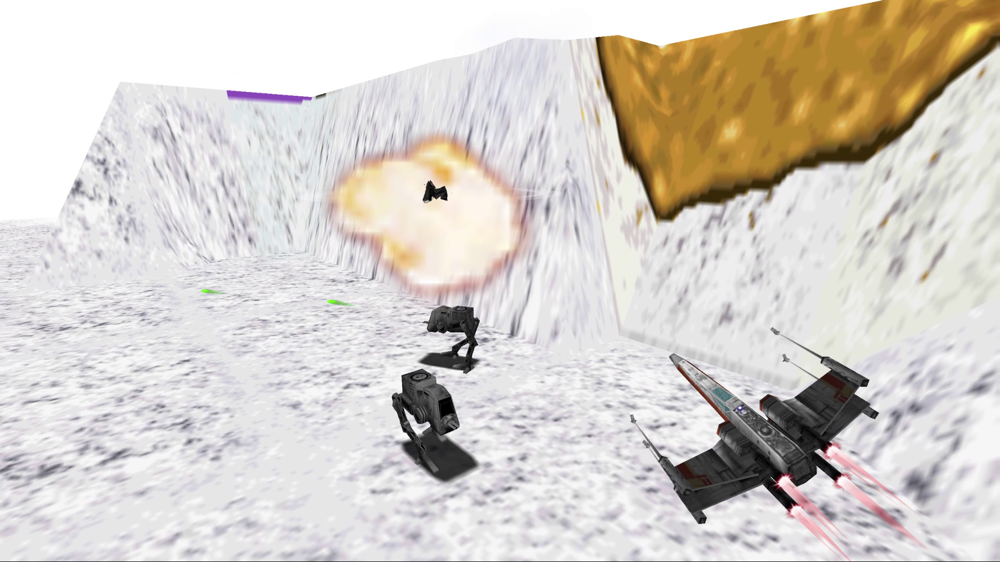
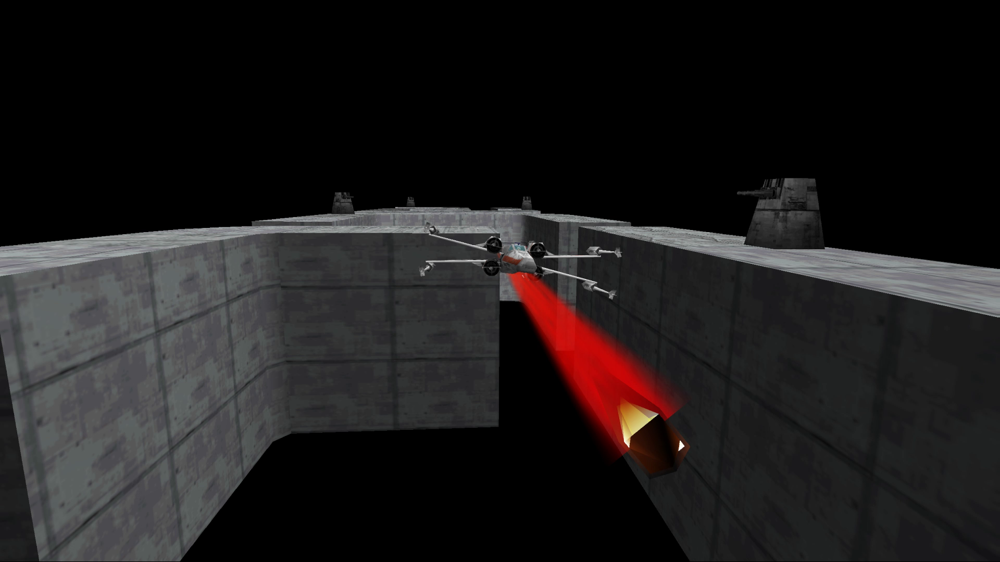
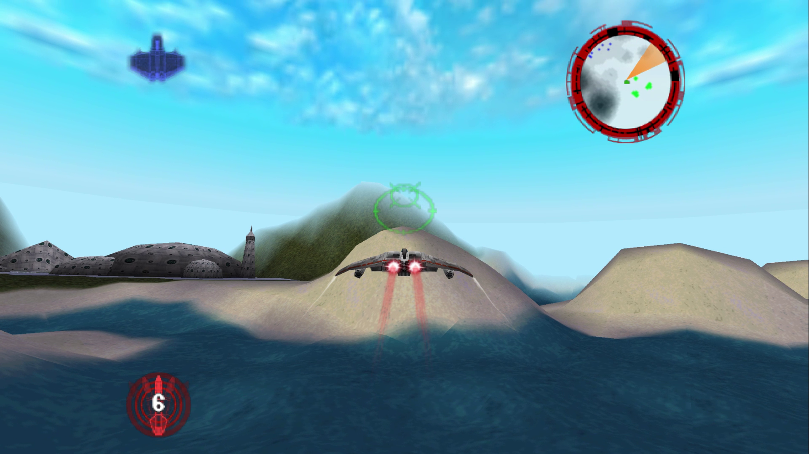
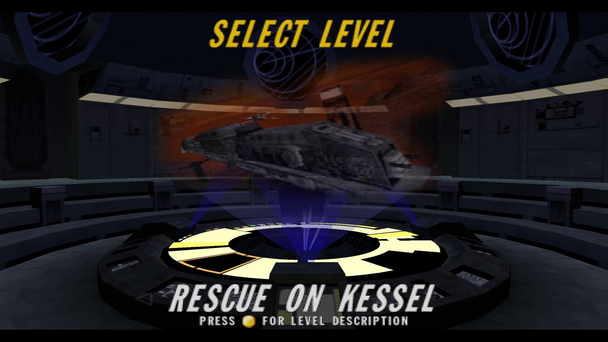
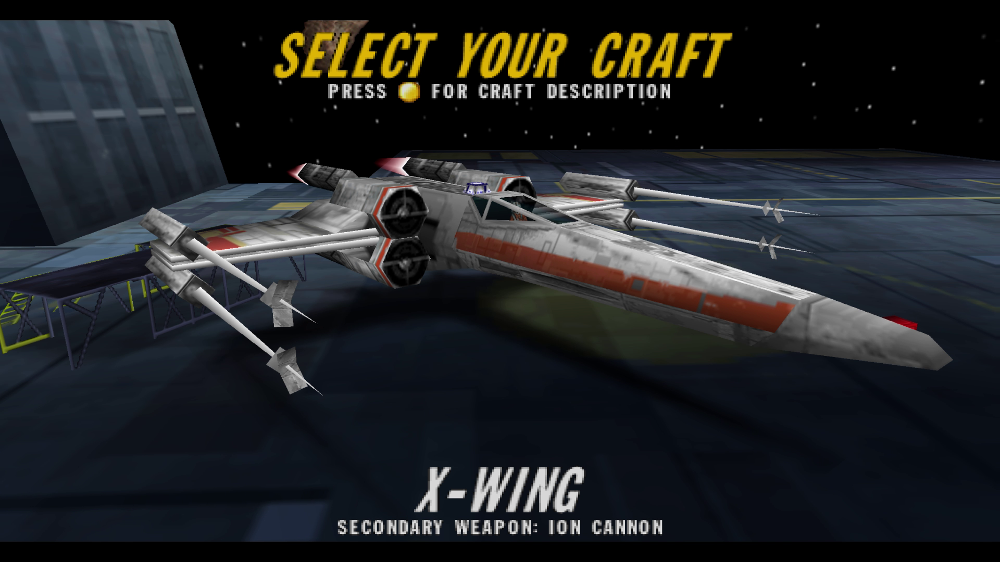
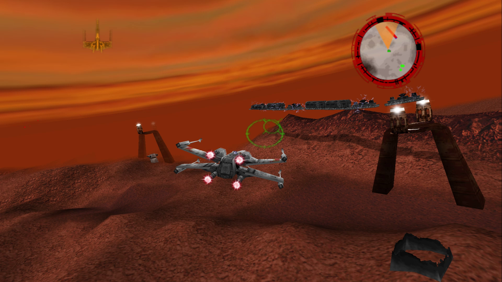
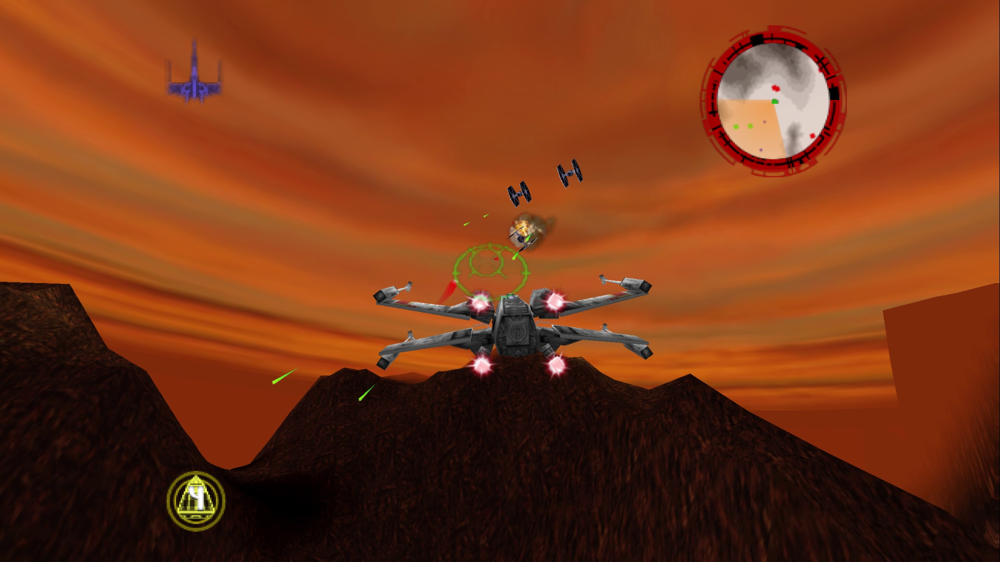
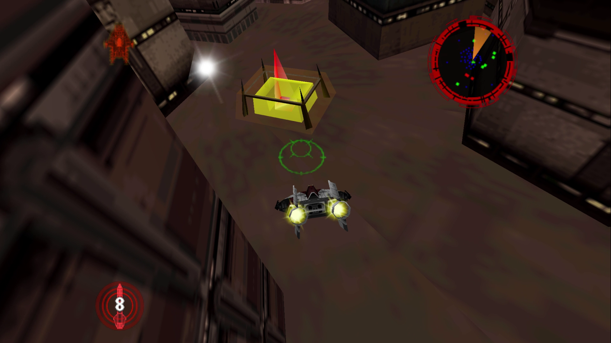

<div align="center">

  [](https://mikesemicolond.github.io/RogueSquadron64Recomp/)

# Rogue Squadron 64 Recompiled

</div>

A static recompilation of **Star Wars: Rogue Squadron** (USA v1.0) for the N64 built with [N64Recomp](https://github.com/N64Recomp/N64Recomp) and [N64ModernRuntime](https://github.com/N64Recomp/N64ModernRuntime), rendering through a forked [RT64](https://github.com/MikeSemicolonD/rt64) that understands Factor 5's custom display-list format.

> [!IMPORTANT]
> **Heavily AI-assisted.**
> Most of the debugging, architectural decisions, and code here were produced with Claude.

---

<div align="center">

### Screenshots

|  |  |  |  |
| --- | --- | --- | --- |
|  |  |  |  |

</div>

## Minimum Requirements

<div align="center">

| Requirement | Details |
| --- | --- |
| **ROM** | Star Wars: Rogue Squadron (USA v1.0) `.z64`, `.v64` or `.n64` (xxHash3-64 `0x6B66A44153594DEA`) |

| OS / Platform | Graphics Backend |
| --- | --- |
| **Windows 10+ x64** | Vulkan, D3D12, D3D11, D3D10 |
| **[Windows 10+ x86 (32-bit)](#4-build)** | Vulkan, D3D12, D3D11, D3D10 |
| **[Linux x64](#linux)** (glibc 2.38+) | Vulkan |
| **[Linux arm64 / armhf](docs/guides/building-all-platforms.md#what-players-need)** (glibc 2.38+) | Vulkan |
| **[Linux x86 (32-bit)](docs/guides/building-all-platforms.md)**** (glibc 2.38+) | Vulkan |
| **[Android 9+ arm64](#android)** | Vulkan 1.1 |
| **[macOS 11+ arm64 (Apple Silicon)](#macos)*** | Metal |
| **[macOS 11+ x86_64 (Intel)](#macos)*** | Metal |

</div>

*macOS builds but hasn't been run on a Mac yet (see [macOS](#macos))

**The 32-bit x86 Linux build has only been tested on a 64-bit PC with software Vulkan.

[Per-platform minimum requirements](docs/guides/building-all-platforms.md#what-players-need).

## Features

#### Graphics

- **High resolutions:** high resolution options, with optional MSAA, SSAA or FXAA anti-aliasing & HDR.
- **Widescreen:** extends the screen (and camera FOV) beyond the old 4:3 aspect ratio.
- **Longer draw distance:** see much farther away by up to 2.5x the original. [Has some caveats](#status).
- **Frame Interpolation:** smooths the game's native ~30 fps to match your monitor's refresh rate.
- **Support for Texture packs:** RT64 texture-replacement packs load at startup.
- **Ray Tracing Support:** reflections, shadows, dynamic lights from lasers and explosions, and light shafts through fog. [experimental](#status).

#### Input

- **Keyboard and mouse:** fly with the mouse and fire with the mouse buttons.
  - **Menu navigation with the Mouse:** ability to seamlessly select and control menu navigation exclusively with the mouse via cursor placement, LMB (Start) & RMB (Back)
- **Gamepads:** any SDL-supported controller works, with gamepad lightbar support.
- **Flight sticks and H.O.T.A.S.:** use the throttle lever to set your speed, and twist or rudder roll.
- **Rumble:** the game's own Rumble Pak effects play on gamepads and force-feedback joysticks. Fully adjustable in `roguesq_input.json`.
- **Full rebinding:** press **F6** in-game to rebind actions, change sensitivity, adjust deadzones, and rumble settings OR use the [Control Settings Mod](#mods). See [Controls](#controls).
- **Touch controls on Android:** tap menu and in-game buttons and fly with an on-screen stick. You can move and resize the buttons, and turn on 'gyro steering' to help fine tune your aim.

#### Languages

- **English (en), German (de) and French (fr):** picked under **OPTIONS > LANGUAGE**. Affects menus, mission text and subtitles while voice acting remains in English.

#### Multiplayer (experimental)

- **Online two-player co-op:** host or join from a **MULTIPLAYER** page on the main menu.
  - Your partner flies alongside you as a wingman, shares objectives, lives, and the mission result. Works over LAN (with automatic discovery) and over the internet (with UPnP port forwarding).
  - Uses [miniupnp](https://github.com/miniupnp/miniupnp) and a fork of [ENet](https://github.com/lsalzman/enet) called [ENet6](https://github.com/SirLynix/enet6).
  - The **Multiplayer** is shipped as a `multiplayer-native` mod.
- **Co-op over Steam using the `steam-relay` mod (Desktop ONLY):** with Steam running, HOST GAME will show a 6-digit join code. A client can replace the IP address field with the code to join the game. Steam sees the game as Spacewar (app id 480).
  - **The Steam API library is not included:** download the Steamworks SDK (version 1.65, from [partner.steamgames.com](https://partner.steamgames.com/downloads/list), any Steam login) and copy `redistributable_bin/win64/steam_api64.dll` (Windows), `redistributable_bin/linux64/libsteam_api.so` (Linux) or `redistributable_bin/osx/libsteam_api.dylib` (macOS) into `mods/steam-relay/`. Without it, or with Steam closed, the MULTIPLAYER will default to using direct connections.
  - Linux needs the native Steam package (**Flatpak and Snap Steam are not supported**); on Steam Deck, add the Linux build as a non-Steam game; on macOS, remove the download quarantine with `xattr -d com.apple.quarantine mods/steam-relay/libsteam_api.dylib`.
- See [docs/guides/multiplayer.md](docs/guides/multiplayer.md) for more details.

> [!NOTE]
> Steam-Relay mod on Linux, Steam Deck and macOS are untested.

#### Mods

- **Mod support:** turn mods on and off in the **Mods** panel of the **F6** window. (some might require resetting the game)
  - Developers can use [mods/platforms.json](mods/platforms.json) to automatically include mods in builds based on platform.
  - See [docs/guides/modding.md for modding info](docs/guides/modding.md).
- **Included mods:**
  - **Display Settings:** 'Display Settings' UI in the main menu under 'Options' -> 'Game Settings' and in the pause menu. Also contains the Ray Tracing and Fullscreen toggle.
  - **Control Settings:** new Controls UI allowing the adjustment of sensitivity, acceleration, deadzone, rumble and Input Bindings. *All while using in-game UI.*
  - **Multiplayer:** online co-op (see above).
  - **Larger Object Pool:** doubles the number of ships, lasers, and explosions the game can track at once, so busy missions stop resetting pooled objects.
  - **Long Tow Cable:** the snowspeeder's tow cable is long enough to wrap an AT-AT several times.
  - **Quit Prompt:** a prompt in the main menu asking if you want to quit.
  - **Invincibility:** your craft takes no damage.
  - **Any Craft, Any Mission:** fly any ship on any level.

## Running

Put `rogue_squadron.z64` (or `rogue_squadron.v64` / `rogue_squadron.n64`) in the working directory (the executable's folder when you double-click it) and launch. The ROM hash is checked and the ROM is imported on first launch.

### Controls

Keyboard, mouse, gamepad, and flight sticks / HOTAS all work; no controller is required. The keyboard and joystick defaults *for the most part* follow the PC version (*Rogue Squadron 3D*).

Actions are for the game's default **Luke** controller setting. The other controller presets in Options rearrange them.

<div align="center">

| Action | Keyboard | Mouse | N64 | Gamepad | Joystick / H.O.T.A.S. |
| --- | --- | --- | --- | --- | --- |
| Steer | <kbd>↑</kbd>,<kbd>↓</kbd>,<kbd>←</kbd>,<kbd>→</kbd> (<kbd>A</kbd>/<kbd>D</kbd> turns) | Mouse X/Y | Analog stick | Left stick | Stick X/Y |
| Fire blasters | <kbd>Space</kbd> | <kbd>LMB</kbd> | B | X | Button 1 (trigger) |
| Fire secondary | <kbd>Alt</kbd> | <kbd>RMB</kbd> | C-Left | Back | Button 2 |
| Fire mode | <kbd>X</kbd> | — | C-Down | B | Button 6 |
| Thrust | <kbd>W</kbd> | — | A | A | Button 3 |
| Brake | <kbd>S</kbd> | — | Z | Left trigger | Button 4 |
| Speed (positional) | — | — | — | — | Throttle lever |
| Roll | <kbd>E</kbd> | — | R | Right shoulder | Button 7 + twist joystick |
| Special | <kbd>F</kbd> | — | C-Right | Guide | Button 5 |
| Cockpit | <kbd>C</kbd> | — | D-Pad Up | D-Pad | — |
| Standard | <kbd>V</kbd> | — | D-Pad Down | D-Pad | — |
| Close view | <kbd>B</kbd> | — | D-Pad Right | D-Pad | — |
| Switch view | <kbd>N</kbd> | — | L | Left shoulder | Button 8 |
| In-Game Profiler HUD | <kbd>F5</kbd> | — | — | — | — |
| Look around | <kbd>Q</kbd> | — | C-Up | Y | Hat |
| Drop camera | <kbd>Z</kbd> | — | D-Pad Left | D-Pad | — |
| Menu confirm | <kbd>Enter</kbd> | — | A | A | Button 3 |
| Back | <kbd>Backspace</kbd> | — | B | X | Button 1 |
| Pause | <kbd>Esc</kbd> | — | Start | Start | — |

</div>

- **Mouse flight steering:** mouse cursor is automatically captured when the game window is focused.
  - Mouse motion steers the craft, left click fires blasters, right click fires the secondary weapon.
  - The cursor displays when the window loses focus, the (**F6**) Controls window is open, or when RT64's (**F1**) inspector is up.

- **Rumble:** the game's own Rumble Pak effects (hits, collisions, terrain scrapes, weapons, the death spiral, and crashing) play on gamepads and on joysticks supporting rumble or force feedback.
  - Hits get stronger with the damage taken, and the rumble keeps going through the death spiral.
  - Rumble and its individual effects can be tuned in the (**F6**) Controls window, or in the `rumble` section of `roguesq_input.json`.

- **Flight sticks and H.O.T.A.S.:** any devices named "joystick" will be bound as a joystick.
  - A stick with exactly three axes, or a device named "throttle", gets its lever bound to **Throttle**.
  - The throttle sets your speed by position: *full back* is the craft's slowest, *full forward* is fastest, and *middle* is normal speed.
  - Other axes can be bound from the Controls window (**F6**)
  
- **Lightbar support via DualShock 4 & DualSense:** light bar color will change depending on the state of the game.
  - Colors configurable from the `lightbar` section in `roguesq_input.json`

> [!TIP]
> When binding the throttle, move the lever to the opposite position, click **Rebind** on 'Throttle', then push/pull it forward/back.
>
> Twist grip or rudder pedals can do one of two things depending on how you bind them. Bind them to **StickLeft/StickRight** and they'll add to `stick X` since inputs on the same stick direction add together.
>
> Bind them to **RollLeft/RollRight** and they'll give a dedicated roll axis. Hold the 'Roll' button then twist to roll.

#### Function Hotkeys

| Key | Action | Builds |
| --- | --- | --- |
| <kbd>F1</kbd> | RT64's ImGui overlay (configuration, texture dumping, per-call debugger, render-target view) | Debug |
| <kbd>F2</kbd> | Toggle ray tracing | All |
| <kbd>F3</kbd> | ViewRDRAM mode | All |
| <kbd>F4</kbd> | Texture replacement | All |
| <kbd>F5</kbd> | In-game profiler HUD | All |
| <kbd>F6</kbd> | Controls window (rebinding, joysticks, rumble, mouse) | All |
| <kbd>F9</kbd> / <kbd>Shift</kbd>+<kbd>F9</kbd> | Step forward / back through the ray tracing debug views | All |
| <kbd>F12</kbd> | Write a crash dump to `dumps/crash-dumps/` (Windows only) | All |
| <kbd>Print Screen</kbd> | RenderDoc frame capture (set `ROGUESQ_RENDERDOC=<path to renderdoc.dll>`, Windows only) | All |

- The current ray tracing debug view is named in a notice at the bottom right.
- Set `ROGUESQ_FULL_DUMP=1` for a full-memory crash dump.
- With RenderDoc loaded, **F12** also takes a capture alongside the crash dump. Launching from RenderDoc works too, without `ROGUESQ_RENDERDOC`.
- **F1** needs RT64 developer mode, on by default in Debug (`ROGUESQ_HLE_DEV_MODE=1` turns it on in Release).
- In Debug builds the RT64 inspector owns the ImGui overlay, so press **F1** before **F6**.

#### Rebinding controls

Rebind in-game under **Options > Controller Settings** (the **Controls Menu** mod, on by default), which lists the actions for the keyboard, gamepad or joystick you open it with. Or press **F6** for the **Controls** window:

- Click **Rebind** or **Add** on an action, then press a key or button or move an axis. **Clear** removes the selected binding.
- **Joysticks / H.O.T.A.S.** shows each joystick's axes live, with invert and deadzone settings.
- **Rumble** holds the rumble settings, plus mouse sensitivity and axis invert.

Bindings are saved to `roguesq_input.json` next to the executable.

## Status

> [!NOTE]
> The game is completely playable from beginning to end.

### Recomp. specific Issues

- Ray Tracing is implemented but has various issues:
  - There are situations where light 'sticks' to the player and begins to flicker

- Frame interpolation issues:
  - The bomb drop crosshair, good example Y-wing during Raid on Sullust
  - Lava explosion particles flicker in place when banking indicating they aren't being ID'd, good example Raid on Sullust

- Shooting at the lava in Raid on Sullust produces fire balls that look dim/muted compared to the other lava explosion effects

- A very high draw distance causes the 'legacy' terrain renderer to render more tiles which degrades performance *severely*. `1.3` is a good distance but at `2.0` or more the performance will suffer. At that distance you'll notice structures and NPCs popping into existence at about the `1.5` mark. Increasing the distance for structures and NPCs to pop in will affect how AI behaves and how events trigger.

### Game specific Issues

- Some CPU performance hitching and slowdown (~20fps) in spots (although not as bad as the real N64 game). This is expected since the game is very CPU heavy with a lot of systems running off of counters based on a variable timestep.

- Cutscenes have screen sizes of varying widths, which could genuinely be an issue with the game itself. (Some cutscenes have black bars on the sides or additional padding, but some don't)

- Very slight cut off at the top of text rects **BUT** this also existed in the original game.

- Terrain tile textures don't align perfectly and seem to have a slight cut off which is more likely a game issue than a recomp. issue.

### Roadmap

- RS64 Explorer Fixes & Improvements

## Building

### Build Requirements

<div align="center">

| OS/Platform | Requirement |
| --- | --- |
| **Windows 10+** | CMake 3.20+, [MSVC with the ClangCL toolset](https://learn.microsoft.com/en-us/cpp/build/clang-support-msbuild) with a [MIPS Toolchain](https://github.com/n64-tools/gcc-toolchain-mips64/releases)* |
| **Linux** | CMake 3.20+, [Clang](https://github.com/llvm/llvm-project/releases) or [GCC](https://gcc.gnu.org/install/binaries.html) |

</div>

*Uses `mips64-elf-gcc.exe` and `mips64-elf-ld.exe` to compile the patches ELF (`patches/`).

### 1. Clone with submodules

```sh
git clone --recurse-submodules https://github.com/MikeSemicolonD/RogueSquadron64Recomp.git
cd RogueSquadron64Recomp
```

`lib/` holds forks of [N64ModernRuntime](https://github.com/MikeSemicolonD/N64ModernRuntime) and [rt64](https://github.com/MikeSemicolonD/rt64), forked because the upstream libraries don't support Factor 5's custom microcode. N64ModernRuntime also contains a forked/modified version of `N64Recomp`.

[enet6](https://github.com/SirLynix/enet6) and [miniupnp](https://github.com/miniupnp/miniupnp) are used exclusively for the multiplayer co-op mod.

> [!NOTE]
> **A *setup script* can do steps 2 - 4 for you.**
>
> It'll ask for the ROM, check for missing tools, then create a Release build.
>
> Re-run it after a `git pull`:
>
> ```sh
> powershell -ExecutionPolicy Bypass -File tools\setup\setup.ps1             # Windows
> ```
>
> ```sh
> bash tools/setup/setup.sh                                                  # Linux
> ```

### 2. Produce the decomp ELF

The recompiler needs an ELF of the game: the ROM's code with every function named and its bounds. You make it from your ROM with the companion [rogue_squadron64](https://github.com/MikeSemicolonD/rogue_squadron64) decomp, cloned next to this repo. From this repo (using Python 3.11+):

```sh
git clone https://github.com/MikeSemicolonD/rogue_squadron64.git ../rogue_squadron64
cp path/to/rogue_squadron.z64 ../rogue_squadron64/   # the ROM goes in the decomp's root
python tools/re/make_elf_from_syms.py                   # writes ../rogue_squadron64/build/roguesquadron.elf
```

`rogue_squadron.toml` reads the ROM and the ELF from exactly those two paths.

The script uses the decomp's `tools/make_elf.py` to write the ELF, but takes the function names from this repo's `syms/rogue_squadron.syms.toml`, so they match `rogue_squadron.toml` and the mods. Only data symbols and unnamed `func_` names come from the decomp.

The decomp's own build (`splat split roguesquadron.yaml && python tools/make_elf.py`) is only for renaming symbols in the decomp. If its names are behind this repo's, N64Recomp fails with this error:

```text
Function ... is stubbed out in the config file but does not exist!
```

### 3. Generate the recompiled C

The recomp's CMake needs `RecompiledFuncs/`, and the recompiled boot and audio microcode, so build `N64Recomp` and `RSPRecomp` first. Why is this needed? Because the game contains custom boot/audio microcode, requiring its own recompilation process.

```sh
cmake -S lib/N64ModernRuntime/N64Recomp -B build-tools -DCMAKE_BUILD_TYPE=Release # Configure the tools
cmake --build build-tools --config Release --target N64RecompCLI RSPRecomp        # Build N64Recomp and RSPRecomp

# From the repo root. Windows (Visual Studio puts the tools in build-tools/Release/)
build-tools/Release/N64Recomp.exe rogue_squadron.toml          # RecompiledFuncs/
build-tools/Release/RSPRecomp.exe rsp/factor5_boot_rsp.toml    # build/factor5_ucode/factor5_boot_recompiled.c
build-tools/Release/RSPRecomp.exe rsp/musyx_rsp.toml           # build/factor5_ucode/musyx_audio_recompiled.c

# Linux / macOS (Ninja or Make put them in build-tools/)
build-tools/N64Recomp rogue_squadron.toml
build-tools/RSPRecomp rsp/factor5_boot_rsp.toml
build-tools/RSPRecomp rsp/musyx_rsp.toml
```

The recomp's build process then fixes up both microcode files in place (`tools/fixup_factor5_ucode.cpp`). Re-run RSPRecomp only when a config under `rsp/` changes.

### 4. Build

Can specify 'Debug' in `config` when debugging. 'Release' provides MUCH better performance.

```sh
# Windows (Visual Studio + ClangCL)
cmake -B build -T ClangCL -DN64RECOMP_EXE=build-tools/Release/N64Recomp.exe
cmake --build build --config Release

# Windows 32-bit
cmake -B build-x86 -A Win32 -T ClangCL -DN64RECOMP_EXE=build-tools/Release/N64Recomp.exe
cmake --build build-x86 --config Release

# Linux / macOS
cmake -B build -DCMAKE_BUILD_TYPE=Release -DN64RECOMP_EXE=build-tools/N64Recomp
cmake --build build
```

After that, the `regen_funcs` target (`cmake --build build --config Debug --target regen_funcs`) regenerates `RecompiledFuncs/`. Re-run it when `rogue_squadron.toml`, the symbols, or the decomp ELF changes.

| CMake option | Default | Purpose |
| --- | --- | --- |
| `N64RECOMP_EXE=path` | `N64Recomp` in the build dir (`Debug/` for Visual Studio) | Recompiler used by `regen_funcs` and the patches build |
| `ROGUESQ_NO_ITER_DEBUG=ON` | OFF | Disable MSVC debug iterators across the whole build for faster Debug runs (Windows) |

Debug builds compile in the D3D12 debug layer; turn it on at runtime with `ROGUESQ_D3D12_DEBUG=1` (`ROGUESQ_D3D12_GPUVAL=1` adds GPU-based validation).

### Linux

Builds and can run on **Ubuntu 24.04**, **Linux Mint 22.3 Cinnamon** and under **WSL2** (GCC 13 / Ninja); native Linux should behave the same with a real Vulkan driver.

Install the dependencies, do steps 1-3 above, then configure and build the game target:

```sh
sudo apt install build-essential cmake ninja-build python3 zip libsdl2-dev libvulkan-dev libgtk-3-dev gcc-mips-linux-gnu binutils-mips-linux-gnu
cmake -B build -G "Ninja Multi-Config" -DN64RECOMP_EXE=build-tools/N64Recomp
cmake --build build --config Debug --target RogueSquadron64Recomp
```

`Ninja Multi-Config` puts the game in `build/Debug/` and `build/Release/` as on Windows, so the VS Code build, run and test tasks work on Linux too (`Configure (Linux)` runs the configure line). Copy the ROM next to the executable.

The MIPS GCC builds the patches ELF and `.nrm` code mods; CMake finds `mips-linux-gnu-gcc` on its own.

- **Wayland:** if the window stays black and the log shows `fault caught ... lib=.../libdecor-gtk.so`, SDL's GTK decoration plugin crashed. Run through XWayland with `SDL_VIDEODRIVER=x11`.

#### About WSL2

> [!NOTE]
> This section on WSL2 can be ignored **unless** you're looking to try to debug/run a Linux build on Windows.
>
> Do not use this method to profile and judge performance since a virtualized Linux machine will not run anywhere near as well as running on bare metal.

- Keep the build directory on the Linux filesystem (e.g. `~/rs64-build`), **not** under `/mnt/…` — CMake's compiler checks can fail with `Operation not permitted` on the Windows drive mount. Source can stay on `/mnt`.
- WSLg supplies the display, PulseAudio (sound), and keyboard/mouse, so the game runs directly. A physical gamepad needs `usbipd-win` to route the USB device to WSL; the keyboard works out of the box.
- WSL's default Vulkan is **llvmpipe (software)** — it runs but hitches. For GPU acceleration, build [Mesa's](https://gitlab.freedesktop.org/mesa/mesa) **[Dozen (`dzn`)](https://gitlab.freedesktop.org/mesa/mesa/-/tree/main/src/microsoft/vulkan?ref_type=heads)** driver (Vulkan → D3D12 → the real GPU via `/dev/dxg`). If the game doesn't detect `dzn` it'll default to software (CPU) rendering.
- The `tools/release/run-wsl-gpu.sh` helper and the `Configure` / `Build` / `Run (Linux/WSL, GPU via dzn)` VS Code tasks wrap this. (`dzn` has no ray-tracing extensions — irrelevant to the current raster path.)

### Android

Builds as an arm64 APK and runs on a **Snapdragon 8 Gen 3 (Adreno 750, Android 16)** phone; other arm64 phones with Vulkan 1.1 should work, but driver quality varies. The Gradle project in `android/` builds the same `CMakeLists.txt` with the NDK.

Needs **Android Studio** (for its SDK, bundled JDK and `adb`) with **NDK 29.0.14206865**; Gradle fetches SDL 2.32.10 and installs its CMake itself. Run the Windows Debug build first: the Android build reuses the generated `RecompiledFuncs/`, `src/game/state_table.inl` and `build/factor5_ucode/*.c`.

```powershell
$env:JAVA_HOME = "C:\Program Files\Android\Android Studio\jbr"
cd android
.\gradlew.bat assembleRelease   # app\build\outputs\apk\release\RogueSquadron64Recomp-release.apk
adb install -r app\build\outputs\apk\release\RogueSquadron64Recomp-release.apk
```

- **Use the Release APK.** The Debug APK compiles the recompiled game code at `-O0` and it stutters a lot. Release is signed with the debug key, so it installs over a Debug build and keeps your data. The VS Code tasks `Build (Android): APK (Release)` and `Install + Run (Android, Release)` wrap the commands above.
- **ROM:** on first launch the system file picker asks for `rogue_squadron.z64` (`.v64` and `.n64` also work); the ROM is checked and imported once. (Pushing it to `/sdcard/Android/data/com.rs64recomp.app/files/` with `adb push` also works.)
- **Controls:** touch controls are on by default: tap menu buttons directly, swipe carousels, and fly with virtual joystick stick and N64-style buttons.
  - Move and resize the touch buttons by using the gear button in the bottom left corner of the screen when navigating menus or by selecting **TOUCH LAYOUT** (Requires [touch-layout](mods/touch-layout) mod) in the pause menu.
  - **GYRO STEERING** (Requires [gyro-toggle](mods/gyro-toggle) mod) in Game Settings turns on tilt steering to allow for fine mouse-like aiming. A paired gamepad will hide the touch overlay.
  - Touch settings live in `roguesq_touch.json`.
- **Mods:** the APK will build and include the mods listed under `android` in [mods/platforms.json](mods/platforms.json) installing them into the app's `mods/` folder.
- **Debugging:** logs go to logcat under the tag `RS64` (the `Logcat (Android)` task filters it). Environment variables go one `NAME=VALUE` per line in `roguesq_env.txt` in the app's files folder.

### macOS

> [!IMPORTANT]
> ***Untested* on a Mac.**
>
> The release has a universal `RogueSquadron64Recomp.app` (Apple Silicon and Intel, macOS 11+) cross-built from Windows with compiled Metal shaders.
>
> It isn't notarized: run `xattr -dr com.apple.quarantine RogueSquadron64Recomp.app` once before opening it.

On a Mac, the Linux / macOS commands above should apply (Xcode Command Line Tools + `brew install cmake ninja sdl2`)

Without a Mac, the game cross-compiles from **WSL2 / Linux** with [osxcross](https://github.com/tpoechtrager/osxcross):

1. Download **Command Line Tools for Xcode 16.4** (`.dmg`) from [developer.apple.com/download/all](https://developer.apple.com/download/all/)
2. Build the toolchain and its Darwin runtime (`libssl-dev cpio libxml2-dev` needed):

   ```sh
   git clone https://github.com/tpoechtrager/osxcross ~/osxcross && cd ~/osxcross
   ./tools/gen_sdk_package_tools_dmg.sh /path/to/Command_Line_Tools_for_Xcode_16.4.dmg
   mv MacOSX15.5.sdk.tar.xz tarballs/
   UNATTENDED=1 SDK_VERSION=15.5 OSX_VERSION_MIN=11.0 ./build.sh
   ./build_compiler_rt.sh   # no need to run the install commands it prints
   ```

3. Install Apple's **Metal Developer Tools for Windows** (search "Metal Developer Tools" at [developer.apple.com/download/all](https://developer.apple.com/download/all/?q=Metal%20Developer%20Tools)). The script compiles the Metal shaders with it; without it the build links but can't render. A different install folder than `C:\Program Files\Metal Developer Tools` goes in `METAL_TOOLS_DIR` (the WSL path of its `bin` folder).
   - **On native Linux** the tools run under Wine (`sudo apt install wine64`): copy the `Metal Developer Tools` folder from a Windows install and point `METAL_TOOLS_DIR` at its `bin` folder. Wine makes byte-identical metallibs, a few seconds per shader slower.
4. Run a native Windows or Linux build first: the cross-build can't run its own build tools, so it reuses that build's generated `state_table.inl` and fixed-up audio ucode.
5. Build the game with `tools/release/macos/cross-build.sh [arm64|x86_64] [Debug|Release]`, or the `Build (macOS cross, WSL/osxcross)` VS Code task. The script builds the host tools and SDL2 on first run. Output: `~/rs64-build-macos-<arch>/RogueSquadron64Recomp` for Debug, `~/rs64-build-macos-<arch>-<config>/` (lowercase, e.g. `-release`) otherwise.
6. Package with `tools/release/macos/package.sh <out.zip> <arm64-build-dir> [x86_64-build-dir]`, or the `Package (macOS .app, WSL/osxcross)` VS Code task: two build dirs make a universal `.app`.

- **Duplicate symbols:** Apple's `ld64` has no `--allow-multiple-definition`, so the runtime functions this game overrides are declared weak on Apple (`ULTRAMODERN_OVERRIDABLE` in the N64ModernRuntime fork).

## Architecture

How the port is put together (recompiled code, the forked RT64 and N64ModernRuntime, frame pacing, audio and the override layer) is in [docs/reference/game-architecture.md](docs/reference/game-architecture.md). [docs/README.md](docs/README.md) indexes the rest of the engine docs, including debugging, native mods and co-op.

## Browser based tools

### [RS64 Explorer](https://mikesemicolond.github.io/RogueSquadron64Recomp/tools/web/rs64-explorer/)

*`tools/web/rs64-explorer`*: Using the original ROM, users and developers alike can view the game at a level never seen before.

A **MASSIVE** extension to the foundational work originally done by [Dávid Pethes](https://github.com/dpethes/rerogue) and [jrra](https://github.com/jrra/rerogue).

- View fully textured Models and sprites along with their animations.
- Fully view the makeup of whole Levels down to the individual triggers, paths and scripted events that make this game come to life.
- View all Visual Effects from complex explosions to simple animated sprites.
- Sound Effects and Voice lines including subtitles.
- MIDI Music Playback with timeline scrubbing allowing you to view the layers of instrument samples [Chris Huelsbeck](https://en.wikipedia.org/wiki/Chris_Huelsbeck) used to masterfully assemble and recreate the Star Wars score.
- [WebMCP Support](https://developer.chrome.com/docs/ai/webmcp) for agentic usage.

### [Save editor](https://mikesemicolond.github.io/RogueSquadron64Recomp/tools/web/save-editor/rs64_save_editor.html)

A save editor also exists in *`tools/web/save-editor`* as an HTML page, allowing a user to easily edit and export a save into any of the following formats: *`.bin`, `.eep`, `.srm`, `.sra` and `.raw`*

## 'Proper' AI Agent Usage

Using an AI Agent properly comes down to handing it the *right set of tools*, *the right resources/knowledge to perform the work* and *instructions*. **AGENTS.MD** provides the baseline instructions for your agent to make changes to this project. In addition to that, **skill** files *(just like AGENTS.MD)* are used to provide instructions for things like tools, specific tasks and/or processes. **MCP** servers/tools can further augment existing applications by giving handles/methods for agents to *better* perform tasks.

This repo already provides **AGENTS.MD** and **skill** files. **MCP** servers are configured and set up by the user themselves and is something we can't force/mandate. Beyond MCP are things called **harnesses** which can be a tool to perform tasks or orchestrate agents to perform a set of tasks at once. This repo contains some harnesses in `tools` to perform tests, perform multiple runs to verify robustness or drive an agent to a particular menu to chase a bug.

Once your agent is set up, tasks that would've taken weeks/months/years to do can be done in a single day/week. (This reason alone is why trillions are being spent in this sector)

Here's a list of MCPs that could be useful for this project:

- [rs64-mcp](docs/engine/rt64-mcp.md) (in this repo, `tools/debug/mcp/rs64_mcp.py`, set up in the local `.mcp.json`) lets an agent launch the game, pause on an exact frame, and inspect draws, textures, framebuffers, RDRAM and screenshots. The game side is built into Debug by default. For Release, configure with `-DRS64_MCP=ON` (or run the VS Code task "Build: RogueSquadron64Recomp (Release, MCP)")
- [renderdoc](https://github.com/Linkingooo/renderdoc-mcp) (Requires [RenderDoc source code](https://github.com/baldurk/renderdoc) and [Python 3.11](https://www.python.org/downloads/) to compile the `renderdoc.pyd` that this MCP needs; the `.pyd` loads only in the Python version it was built with, so the MCP server must run on that same 3.11)
- [windows-screenshot-mcp-server](https://github.com/MikeSemicolonD/windows-screenshot-mcp-server) (Requires [go 1.25.2](https://go.dev/dl/))

> [!CAUTION]
> `windows-screenshot-mcp-server` usage can be finicky.
>
> While Claude (*as of **September 2026***) can view pixels in the screenshots, it can miss things that are visually obvious to a human like visual glitches or rapidly flickering artifacts.
>
> (Good enough to be useful, not good enough to trust blindly)

## Tooling

[RenderDoc](https://renderdoc.org/) to debug graphics/rendering issues.

[rizin](https://rizin.re/) to assist in validating/checking the game's assembly.

[pj64](https://www.pj64-emu.com/nightly-builds) to pull memory dumps for checks and comparisons. (Development builds are recommended since they provide more ways to debug/validate *even though it performs slower*)

## Contributors

- **[terminalcommand](https://github.com/terminalcommand)**: Assisted in improving the Linux build process, fixed missing tool calls in the CMakeLists, fixed Wayland crashes on Linux and added borderless fullscreen argument.

## Acknowledgements

- **[Dávid Pethes](https://github.com/dpethes/rerogue)**: the rerogue tools and the [satd.sk write-up](https://satd.sk/pages/rs/) documenting the PC build's HOB, HMT, HMP, and MORT formats, which the N64 build shares.
- **[jrra](https://github.com/jrra/rerogue)**: a community fork of rerogue.
- **[Tmcg2](https://github.com/Tmcg2/rogue_squadron64)**: started the companion decomp project.

## License

The code in this repository (the host runtime, patches, hooks, mods, tools and docs) is licensed under [GPL-3.0](LICENSE).

The license covers only that code. **The game itself is not part of this project and is not covered by it:** this repository contains no ROM data, no game code and no game assets. The recompiled code is generated from the ROM at build time and is never committed. Release builds include that compiled code but no ROM data or game assets. You need a legally obtained copy of the game.

Star Wars and Rogue Squadron are trademarks of Lucasfilm Ltd. This is an unofficial hobby project with **no** association with, sponsorship by or endorsement from Nintendo, Disney, Lucasfilm (including Lucasfilm Games, formerly LucasArts), "Factor 5, Inc."/"Factor5 GmbH" or "Eggebrecht, Engel, Schmidt GbR".
