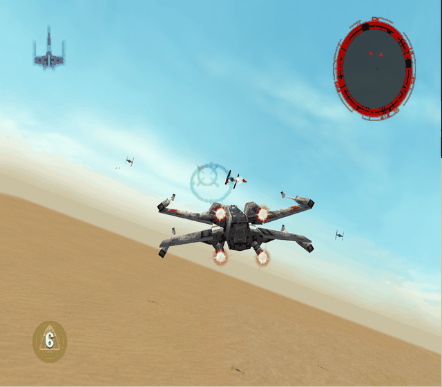
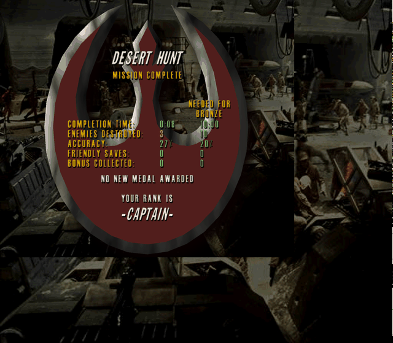

# Make a custom level

A new mission, shown in SELECT LEVEL after the last unlocked level, with its own ground, enemies, objectives, briefing, crawl, cutscenes, models and textures. Its medals are saved apart from the game's progress.

## 1. Start the level

Open a stock level in **Levels** and pick:

- **New level from this one**: a full copy.
- **New blank level**: a player start on flat ground, blank 3-second intro and ending, and the original's sky, ground textures and music.

It opens in the editor, ready to build. Rename it in Level settings.

The stock level it starts from, its *template*, sets the sky, ground textures and map size.

## 2. Level settings

**Level settings…** opens beside the level and saves as you go.

- **Title** and **description** for SELECT LEVEL.
- **Briefing**: a game voice line, or **Import recording…** (`.wav`, `.mp3`).
- **Approved craft**: the hangar shows every owned ship, but only approved ones launch.
- **Medals**: time, kills, accuracy and friendlies saved per medal, kept per save slot.
- **Opening crawl** and **starting song**.

### Objectives

Your objectives (1 to 4) replace the template's mission. In the editor, click **Objectives…** to open them beside the level; they save as you go. **Add objective**, then click units in the view (**Esc** when done). Change the goal or its pause-screen line (up to 40 characters) if you like:

| Goal | What it does |
| --- | --- |
| Destroy units | Done when every picked unit is destroyed |
| Reach an area | Done when the player enters the trigger area you click in the view. The add icon makes one where you look |
| Survive for | Done when the minutes pass |
| Protect a unit | Fails if the unit is destroyed |
| Finish within | Fails when the minutes run out |

The level is won when every Destroy, Reach and Survive objective is done, so it needs one of those.

Under each objective's **Voice and camera**:

- **When done**: a voice line or your recording, with subtitle. Protect and Finish within play it on failure.
- **Camera**: a level camera the game cuts to then.
- **Pause screen**: what the pause screen reads aloud for this line.

[Rules](Make-a-Level-Mod#rules-when-this-happens-do-that) can also complete, fail or react to objectives.

## 3. Build it

- [Reshape the ground](Make-a-Level-Mod#reshape-the-ground)
- [Place things](Make-a-Level-Mod#move-add-and-remove-things), [enemies and waves](Make-a-Level-Mod#enemies-and-waves), [flight paths](Make-a-Level-Mod#flight-paths)
- [Triggers, music, camera shots](Make-a-Level-Mod#trigger-areas-music-and-camera-shots) and rules
- [Models and textures](Make-a-Model-Mod): a level and its custom ship export together
- [Crawl, intro and ending](Make-a-Cutscene-Mod): a blank level's start empty

**Play in game** starts in your level ([Saving, testing and sharing](Saving-Testing-and-Sharing)).

## Example: a short hunt on Tatooine

1. Open Ambush at Mos Eisley and pick **New blank level**.
2. **Level settings…**: title *Desert Hunt*, a description, the X-wing approved.
3. In Objects mode, **Add to level** → *TIE fighter* (from another level), click three spots ahead of the start. They attack on their own; **New path** gives one a route.
4. **Objectives…**, **Add objective**, click all three in the view.
5. Set the medals and **Play in game**.

The last kill ends the mission:

To make the player land too, look at the outpost spot, add a **Reach an area** objective and click its add icon. Set the area's **Radius** in Events mode.

## Not yet possible

- Enemy craft other than TIE fighters and interceptors from other levels ([list](Make-a-Level-Mod#not-yet-possible)).
- A map bigger than its template.
- Your own model as a **new** selectable ship.
