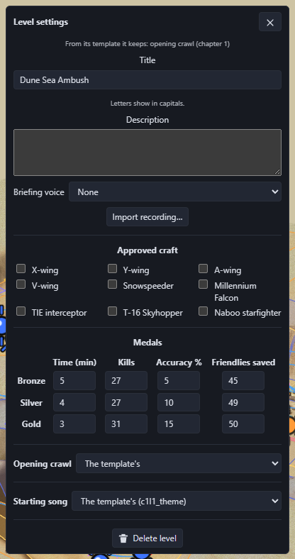
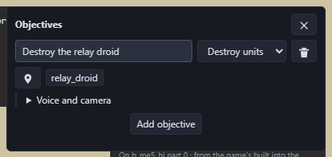

# Make a custom level

A custom level is a new mission that shows in SELECT LEVEL after the last level the player has unlocked. It can have its own ground, enemies, objectives, briefing, opening crawl, intro and ending cutscenes, models and textures. Its medals are saved separately from the game's, so playing it never changes the player's progress.

This guide puts the other guides together, roughly in the order you'd build a level.

## 1. Start the level

Open a stock level in the **Levels** tab and pick one:

- **New level from this one…**: a full copy of the level to change.
- **New blank level…**: only a player start on flat ground, a blank 3-second intro and ending, and the original level's sky, ground textures and music.

Every custom level runs on top of a stock level, its *template*. The template decides the sky and the ground textures, and the size of the map.

## 2. Level settings

**Level settings…** holds what the player sees before and after the mission:

- **Title** and **description** for SELECT LEVEL.
- **Briefing**: pick a voice line from the game, or **Import recording…** to use your own `.wav` or `.mp3`.
- **Approved craft**: which ships the player can pick.
- **Objectives** (1 to 4): see [Objectives](#objectives) below.
- **Medals**: time, kills, accuracy and friendlies saved for bronze, silver and gold.
- **Opening crawl** and **starting song**.

### Objectives

With objectives of your own, none of the template's mission runs: your objectives decide when the mission is won or lost. Click **Add objective** (up to four), write the line the pause screen shows for it (up to 40 characters), and pick its goal:

| Goal | What it does |
| --- | --- |
| Destroy units | Done when every unit picked in its list is destroyed (Ctrl+click picks several) |
| Reach an area | Done when the player enters the trigger area picked |
| Survive for | Done when the minutes have passed |
| Protect a unit | The mission fails if the unit picked is destroyed |
| Finish within | The mission fails when the minutes run out |

The level is won when every *Destroy units*, *Reach an area* and *Survive for* objective is done, so it needs at least one of those. The explorer picks the game's internal counters and flags for you.

Under each objective:

- **When done**: a voice line from the game, or **Import recording…** for your own, played with its subtitle when the objective is done. For *Protect a unit* and *Finish within* it plays when the objective fails.
- **Camera**: the game cuts to one of the level's camera positions at the same moment.
- **Pause screen**: what the pause screen reads aloud for this objective's line. With none it stays silent.

Rules can also complete or fail an objective, and react when one is done or failed: see [rules](Make-a-Level-Mod#rules-when-this-happens-do-that).

## 3. Shape the ground

See [Make a level mod: reshape the ground](Make-a-Level-Mod#reshape-the-ground).

## 4. Place things and enemies

See [move, add and remove things](Make-a-Level-Mod#move-add-and-remove-things), [enemies and waves](Make-a-Level-Mod#enemies-and-waves) and [flight paths](Make-a-Level-Mod#flight-paths).

## 5. Make it react

Add trigger areas, music regions, camera shots and rules: see [Make a level mod](Make-a-Level-Mod#trigger-areas-music-and-camera-shots).

## 6. Custom models and textures

Repaint anything placed in the level with **Replace texture from image…**, or give a player craft your own model. See [Make a model mod](Make-a-Model-Mod). A level and the custom ship it uses always export together.

## 7. Opening crawl, intro and ending

Your level's Cutscene list has its intro, ending and **Opening crawl**. See [Make a cutscene mod](Make-a-Cutscene-Mod). A blank level's intro and ending start empty, so build them from scratch: add actors, cameras and voice lines.

## 8. Play it and share it

**Play in game** starts the game straight into your level. See [Saving, testing and sharing](Saving-Testing-and-Sharing).

## Example: a short hunt on Tatooine

A level where the player destroys three TIE fighters and reaches a landing area.

1. Open Ambush at Mos Eisley in **Levels** and pick **New blank level…** for flat ground with the Tatooine sky.
2. **Level settings…**: title *Desert Hunt*, a one-line description, a briefing voice line, and the X-wing as the approved craft.
3. In Objects mode, open **Add to level**, search *TIE fighter* (from another level) and click three spots ahead of the player start. Give each one a path with **New path** in its panel.
4. In Events mode, add a trigger area past the TIEs and name it *landing*.
5. Back in **Level settings…**, **Add objective** twice:
   - *Destroy the TIE fighters*: goal **Destroy units**, Ctrl+click all three.
   - *Land at the outpost*: goal **Reach an area**, pick *landing*.
6. Set the medal times, kills and accuracy, then **Play in game**. Destroying the TIEs and flying into the area ends the mission with the medal screen.

> TODO: screenshots of this example in the game, up to the medal screen.

## Not yet possible

- Enemy craft other than TIE fighters and TIE interceptors from other levels (see the [level mod list](Make-a-Level-Mod#not-yet-possible)).
- A map bigger than its template.
- Your own model as a **new** ship to pick, with its own hangar shot.
- Still to be checked in the game: approved craft for custom levels, medals on save slots 1 and 2, imported briefing recordings, and a camera position copied into a blank level (**Add to level**) used as an objective's camera.
