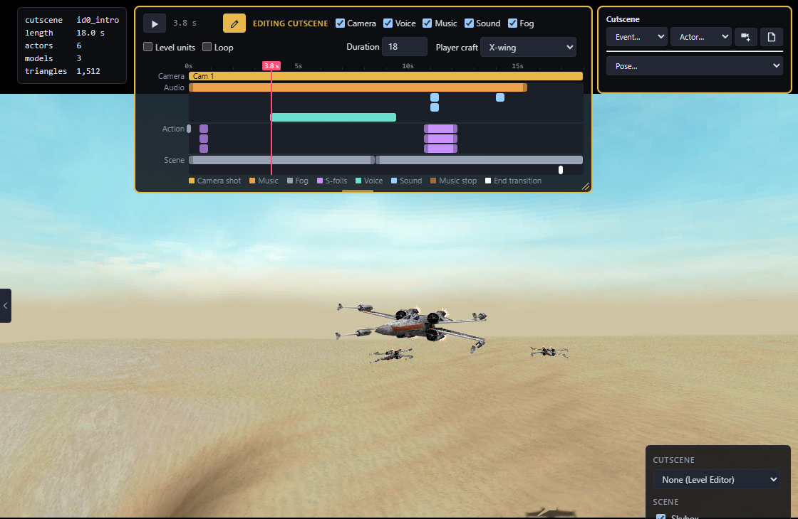
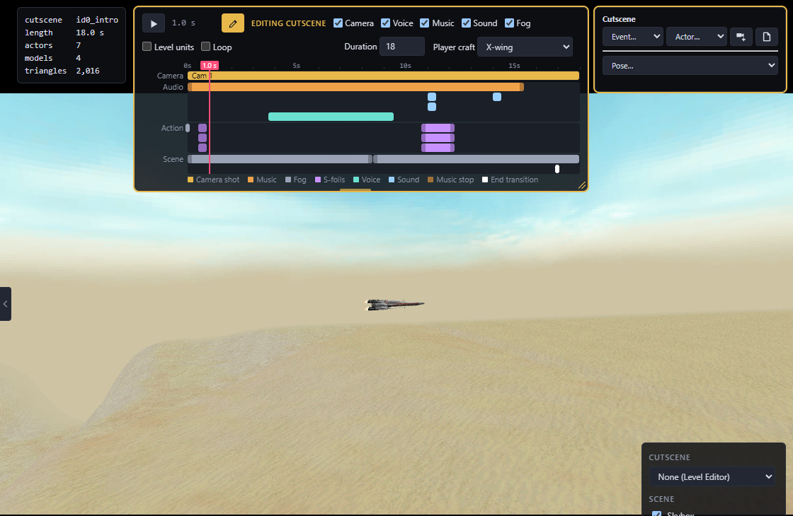

# Make a cutscene mod

Edit a level's intro and ending, and a chapter's opening crawl.

## Open a cutscene

1. In **Levels**, pick a level.
2. Pick from **Cutscene**: intro, ending, medal ceremony, opening crawl or a mid-mission sequence.
3. It plays with voices, music, sound and fog; the checkboxes under the timeline turn each off. **Camera** off lets you fly freely.

**Player craft** swaps the intro's ship; **Medal tier** picks the ceremony.

## Add or delete one

The **plus** next to the list adds what the level can still have:

- **Mid-mission sequence**: camera shots played during the mission, starting at your current view. **New shot** adds up to 6, and each cuts to the next. Give it a **Name**, then start it from a trigger area's camera shot or a rule's *Cut to camera*. A timeline cutscene can't play mid-mission, since the game would have to leave the mission.
- **Opening crawl**: custom levels only. Stock levels have one only where a chapter opens.

The **trash** next to the list asks first, then deletes a sequence or crawl. Intros and endings can't be deleted; use **Start from blank**.

## Edit it

Click the **pencil** on the timeline. The inspector window opens.

### The timeline

- Drag a clip to move it, its ends to trim it.
- Drag voice lines, sounds and music onto it.
- **Event…** adds an event at the playhead. **Fade in** comes up from black over one second.
- **Duration** lengthens or cuts the end.

### Actors

- **Actor…** adds a cutscene model or player craft.
- **Model** swaps the picked actor's model.
- **Shoot at…** makes it turn and fire; the target blows up on hit.

### Shots

Drag the view to frame a shot, move the playhead and click **New shot** (camera with a plus). It cuts to a new camera there, up to 6. At the start or on an existing cut it reframes that shot.

With a camera picked, one click sets what this shot does; click again to turn it off:

- **Follow** chases an actor from where the camera is.
- **Aim** stays put and turns to watch it.
- **Ride** looks out from its cockpit.

### Movement

- **Draw route** (with an actor picked): click points in the view and it flies them from the playhead to the end, nose first and banking. Points keep the route's height; click the sky to climb toward that spot. **Esc** when done.
- **V** adds a point where you are looking, or snaps a camera to your view.
- For anything else, pick a camera or actor from **Pose…**, move the playhead and drag the handles (W move, E rotate, R scale) to set a *key*. **F** focuses the view on what you picked.
- Drag or delete points and keys on the **Keys** row. Closer points fly faster.

**Start from blank** keeps one still camera and removes the rest (undoable).

### Example: an X-wing flies past the camera

1. Open the Ambush at Mos Eisley intro and click the pencil.
2. **Actor…** → the X-wing player craft.
3. **Draw route**, click three points across the view, **Esc**.
4. Tick **Camera** and play.

   

5. Optional: drop an engine sound on the timeline.

To track it, pick the camera and click **Aim**.

## Opening crawls

Chapter and custom levels have **Opening crawl** in the Cutscene list:

- Write the **chapter line**, **title** and **story text**; a blank line starts a paragraph. Unsupported characters are left out.
- Pick the **planet**, or right-click the backdrop to use your own image.
- With the pencil on, **Camera** poses the camera; drag the fly-by ships' route points.

A stock chapter's crawl is replaced by yours.

## Finish

[Try it in the game and export it](Saving-Testing-and-Sharing). **Play in game** starts at the open cutscene.

## Not yet possible

- The crawl preview's fly-by ships don't change with the planet.
- A full intro built from blank is untested.
