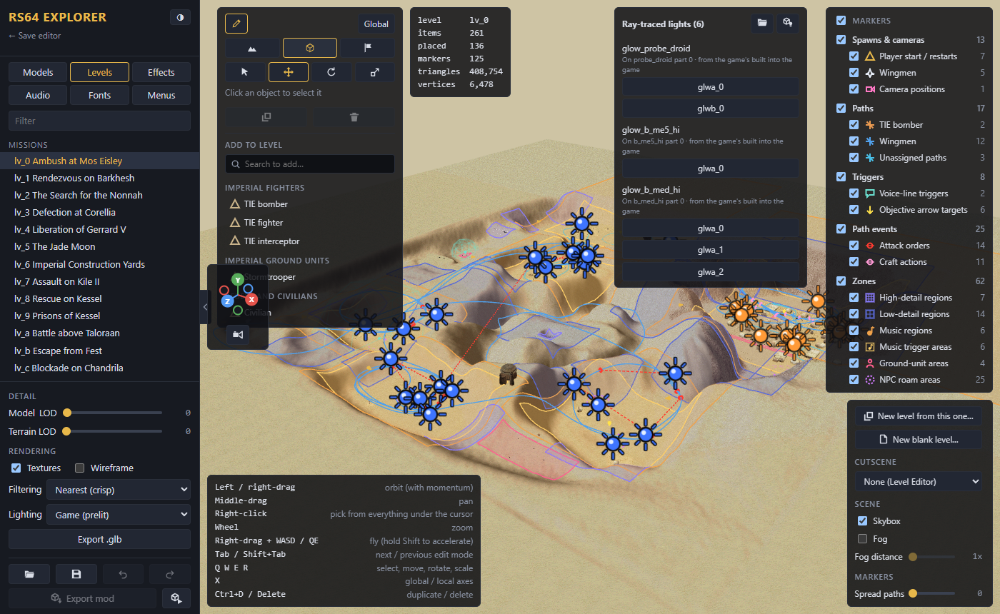
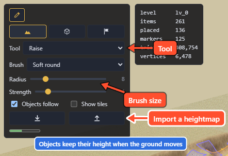
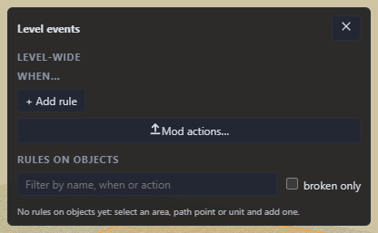
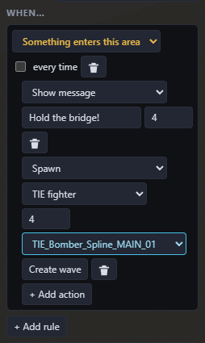

# Make a level mod

A level mod changes one of the game's missions: the ground, what's placed in it, where enemies fly, and what happens when.

To build a new mission instead, see [Make a custom level](Make-a-Custom-Level). It uses all the tools on this page.

## Open the editor

1. Open the **Levels** tab and pick a level.
2. Click the **pencil** button at the top of the view to start editing. Changes go into your project; nothing touches the game until you export.
3. Pick one of the three edit modes (Tab cycles through them):
   - **Terrain**: reshape and repaint the ground.
   - **Objects**: buildings, turrets, enemies, wingmen and everything else placed in the level.
   - **Events**: flight paths, trigger areas, music regions and the level's rules.

## Reshape the ground

In Terrain mode, pick a **Tool** and drag on the ground:

- **Raise**, **Lower**, **Flatten**, **Smooth** reshape it. **Radius** sets the brush size and **Strength** sets how much each stroke changes. The circle under the cursor shows the brush, and the line at the bottom of the panel shows the ground height there.
- **Paint texture** paints ground tiles with the texture picked in the swatches below it. **Pick texture**, or **Alt+drag** with any tool, picks up the texture under the cursor.
- **Brush** picks soft or hard edges and a round or square shape. A hard square with **Flatten** makes flat pads with straight edges, and Flatten's **Height** box sets the height to level to (empty uses the ground where you start).
- Keys: **1** to **6** pick the tool, **[** and **]** shrink and grow the brush, and **Shift+drag** swaps Raise and Lower.
- With **Objects follow** ticked, things on the ground keep their height above it as you reshape it. **Show tiles** outlines the ground tiles, and the tiles a paint stroke changed flash briefly.

You can also work on a heightmap in an image editor. The download button saves the ground as a grey PNG (white is high), and the upload button loads any image back, scaled to fit the level.

A level holds at most 8191 different ground tiles. The bar at the bottom of the panel shows how many are used and turns yellow, then red, as it fills. When the level is close to the limit, the explorer drops tiles that are no longer used anywhere, such as leftovers from earlier edits. A stroke that would still go over the limit is undone and the panel says so. Smoother shapes use fewer tiles.

## Move, add and remove things

In Objects or Events mode:

- **Click** something to select it, and **right-click** to pick from everything under the cursor.
- **W**, **E**, **R** move, rotate and scale it with the handles. **X** switches between world and local axes. The panel also has number boxes for exact values.
- **Name** in the panel renames it. Rules, camera shots and the units flying a renamed path follow the new name. Objects the mission's own script looks up by name can't be renamed.
- **Ctrl+D** duplicates it and **Delete** removes it. The explorer won't let you delete something the mission needs (for example the target of an objective), and tells you why.

To add something, use **Add to level** at the bottom of the panel. Search the list, pick an item, then click where it goes (Esc cancels). Items marked *from another level* are copied from that mission. You can also drag a row in by its grip icon.

## Enemies and waves

An enemy can belong to a **wave**: it waits off-stage until something releases it, such as the player entering an area or a target being destroyed. Pick the wave from the enemy's panel, or **New wave…** to start one. TIE fighters and TIE interceptors can be added from other levels.

A wave comes in one of two ways:

- **From a trigger area.** In Events mode, select the area and pick the wave in its **Start wave** box. The wave comes in when the area is set off.
- **From a rule.** Add the **Spawn** action to a rule (see [Rules](#rules-when-this-happens-do-that)), pick the enemy kind, how many (up to 8) and the path they fly, then click **Create wave**. The explorer adds those enemies to the level, waiting off-stage, and the button changes to *Wave ready*. They come in when the rule runs.

## Flight paths

Enemies and wingmen fly along paths. Pick an existing path from the unit's panel. Each path is named after what flies it, and *(then attacks the player)* marks the ones that end in an attack run. **Copy from another level…** brings in a path from another mission, and **New path** starts a short straight one at the unit. Every copied or new path ends in an attack on the player, because a craft that reaches the end of a path leading nowhere crashes the game.

Select a path in Events mode to edit its points. Drag a point to move it, or **Shift+drag** to change its height. **Ctrl+click** a point to add one after it, and **Alt+click** to delete it (a path keeps at least 4). The craft starts at the second point and stops at the second-last; the first and last only shape the curve.

## Trigger areas, music and camera shots

In Events mode:

- A **trigger area** fires when something enters it. **Set off by** in its panel picks what that is: the player or one of the level's named units. Check it on triggers copied from another level, which can still name that level's units.
- A **music region** changes the song when the player flies into it. Pick the song by name.
- A trigger can **Play camera shot**: the game cuts to one of the level's cameras the first time the trigger fires, then hands control back while the fight goes on. In online co-op, both players see the shot unless you set it to show only for the player who fired it.

## Rules: "when this happens, do that"

Rules let a level react to the player without any code. Select the thing a rule is about (a trigger area or path in Events mode, a unit in Objects mode) and click **+ Add rule**. Pick **When…** and then what to do.

A rule can start when:

- something enters or leaves an area
- a unit passes a point on a path
- a unit is destroyed, or its health drops below a set amount
- the mission starts, or some time after it starts
- an objective is done or failed

It then runs its actions in order:

- play a voice line or your own recording
- show a message on screen
- change the music
- release an enemy wave (**Spawn**)
- cut to a camera, or destroy a unit
- win or fail the mission, or mark an objective done or failed
- wait a few seconds before the next action

A rule fires once unless you make it repeat. **Level events…** opens a window with the level-wide rules (mission start, timers, objectives) and a list of every rule in the level. A rule whose object you deleted shows red there, and Export mod warns you about it.

### Example: hold the bridge

The player flies in, is told to hold the bridge, a wave of TIE fighters attacks, and destroying a target wins the mission. Built on a copy of Ambush at Mos Eisley (**New level from this one…**):

1. In Events mode, select a trigger area on the player's way in and name it `bridge_entry` in its **Name** field. Check its **Set off by** is *The player*.
2. Click **+ Add rule** and pick *Something enters this area*.
3. **+ Add action**: *Show message*, type `Hold the bridge!` and give it 4 seconds.
4. **+ Add action**: *Spawn*, pick *TIE fighter*, 4, and a path for them to fly. Click **Create wave**.
5. In Objects mode, select the unit the player must destroy (a probe droid works) and name it `relay_droid`.
6. Click **+ Add rule**, pick *This unit is destroyed*, then **+ Add action**: *Win the mission*.

On a custom level the same win can come from an objective instead (*Destroy units*, picking `relay_droid`): see [objectives](Make-a-Custom-Level#objectives).

## Lights

Right-click the ground and pick **Add light here** for a ray-traced light in the level. Drag the bulb to move it.

## Finish

[Try it in the game and export it](Saving-Testing-and-Sharing).

## Not yet possible

- Adding enemy craft other than TIE fighters and TIE interceptors from other levels.
- Making a map larger than the level it started from.

Still to be checked in the game: new and edited flight paths, a camera position copied from another level used in a camera shot, a unit chosen in **Set off by**, and the *Show message* and *Play recording* actions.
