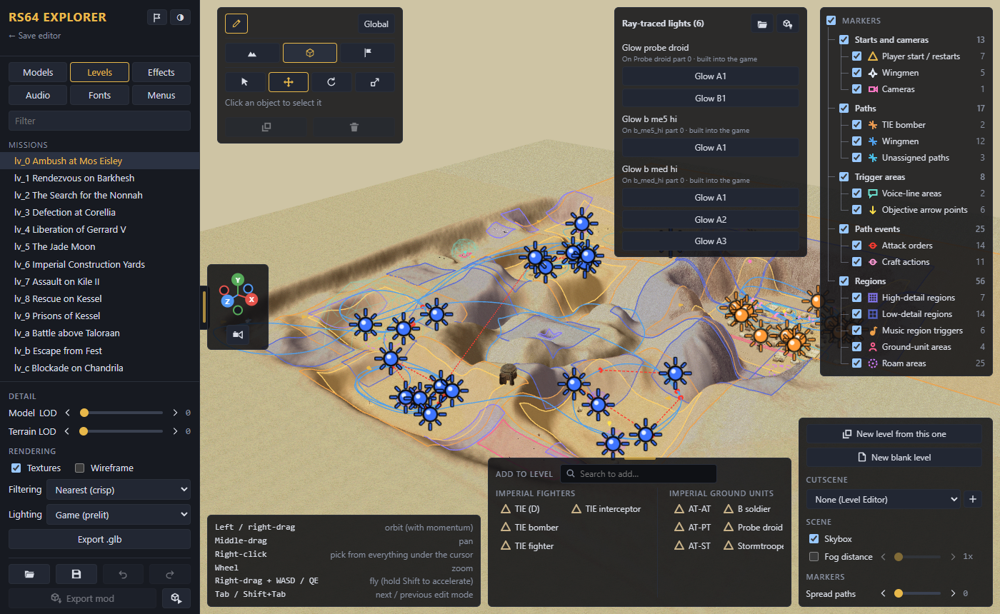
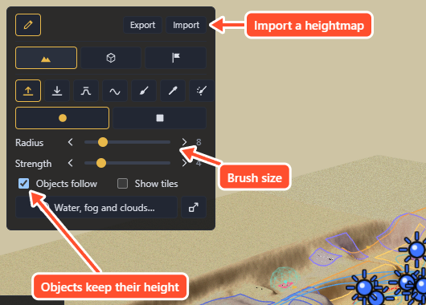
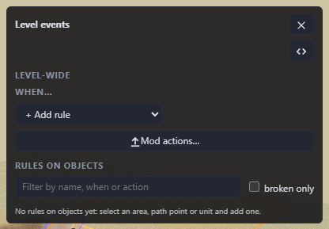
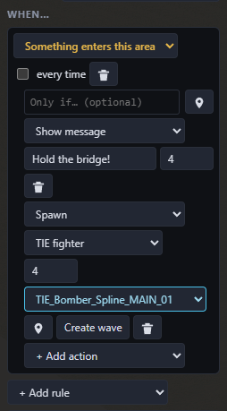

# Make a level mod

Change a mission's ground, objects, enemy routes and events. For a new mission, see [Make a custom level](Make-a-Custom-Level).

## Open the editor

1. In **Levels**, pick a level.
2. Click the **pencil** at the top of the view. Nothing touches the game until you export.
3. Pick an edit mode (Tab cycles, Objects first):
   - **Objects**: buildings, turrets, enemies, wingmen and the rest.
   - **Events**: flight paths, trigger areas, music regions and rules.
   - **Terrain**: shape and paint the ground.

## Reshape the ground

In Terrain mode, pick a **Tool** and drag:

- **Raise**, **Lower**, **Flatten**, **Smooth**, with **Radius** and **Strength**.
- **Paint texture** paints the picked swatch. **Pick texture** or **Alt+drag** picks one up.
- The two shape buttons make the brush round or square. Flatten's **Height** sets the level (empty: where you start).
- Keys: **1**-**6** tools, **[** **]** brush size, **Shift+drag** swaps Raise and Lower.
- **Objects follow** keeps things on the ground. **Show tiles** outlines tiles.

**Export** saves a grey heightmap PNG (white is high); **Import** loads any image back. The **map size** button beside **Water, fog and clouds** shows the map's edges (yellow) and the flight area (red), each with a handle on every side. Drag a yellow side out to grow the map that way, up to 128 x 128 cells of 2 units; the outline shows the new size, and the map is made when you turn the button off. The ground continues from the old edge. Growing the -X or -Z side moves everything in the level over with the old ground, including its cutscenes and this mod's level lights. The game's own lights for that level move too on a stock level; a mod level's don't. Drag a red side to move where the craft is turned back.

A level holds 8191 different ground tiles; a bar shows use once a level passes 80%. Unused tiles are dropped near the limit, and a stroke past it is undone. Smoother shapes use fewer.

## Move, add and remove things

In Objects or Events mode:

- **Click** to select; **right-click** picks from everything under the cursor.
- **W**, **E**, **R** move, rotate, scale; **X** toggles world / local axes, **F** focuses the view on it. The panel has exact values.
- **Name** renames it; rules, camera shots and paths follow. The player start and names a stock script uses can't change.
- **Ctrl+D** duplicates, **Delete** removes (refused, with the reason, if the mission needs it).
- A window beside the panel lists its objectives and level events: its rules, when it spawns and what destroying it spawns.

**Add to level** (the bar along the bottom, which scrolls sideways): pick an item and click where it goes, or drag it in by its grip. Enemies keep placing until **Esc**. *From another level* items are copied from that mission. A **Camera** is added at your view.

## Enemies and waves

A unit that doesn't start in the level has a **Spawns** level event saying when it enters: with a **wave** (started when a trigger area is entered, or by a level event), or **when an object is destroyed** (pick the condition, then the object). **+ Add…**, *Spawn this later, not at the start* adds one. Power-ups and the troopers that pour out of a destroyed bunker work this way. A unit's **When destroyed** level event lists what destroying it spawns and the cutscenes that play; click it to change them, or add one with **+ Add…** (in the list or that window). Troopers that appear in a ground-unit area show it as **Area**. Units from other levels, including turrets and vehicles, are in **Add to level**.

A wave is released:

- **By a trigger area**: in Events mode, its **When entered** level event, **Start wave**.
- **By a rule**: the **Spawn** action. It starts with your last kind, count (up to 8) and path; change them or click a path in the view with the pin, then **Create wave**.

Behind a wave is a mission flag: something sets it (an area entered, a unit destroyed) and the units waiting for it spawn. The **globe** list shows every flag the level uses, such as *When flag 2 is set, spawn …*. Click one to give it a name (the name replaces the number everywhere), see what sets it, and spawn more units with it: search, tick the units, or tick **All shown**, then **Spawn**. The spawn pickers in **When destroyed** work the same way.

## Flight paths

Pick a path in the unit's panel. *(then attacks the player)* marks paths ending in an attack run. **Copy from another level…** or **New path** add one; both end in an attack, since a path leading nowhere crashes the game.

In Events mode, drag a path's points (**Shift+drag**: height, **Ctrl+click**: add after, **Alt+click**: delete, minimum 4). Craft fly from the second point to the second-last.

## Trigger areas, music and cutscenes

In Events mode:

- A **trigger area** triggers when something ticked under **Entered by** (in its **Event trigger** section, above its level events: the player or any unit) comes within its **Radius**; tick several and **Save**. Copied triggers start entered by the player, radius 10 or more.
- A **music region** changes the music when the player enters its inner box, can switch to an action song when an objective calls for it, and ends when they leave the outer box.
- What entering an area does is one **When entered** level event: play a cutscene the first time it fires (in co-op both players see it unless set **Personal**), destroy objects, or start a wave. Click it to change them, or add one with **+ Add…**.

Every kind of marker is explained in the [Level reference](Level-Events), or click **?** on the item.

## Rules: "when this happens, do that"

Select a trigger area, path or unit and click **+** on the **Level events** list beside its panel (for a unit, **+ Add…**, *Another level event*). The **Level events** window opens on that object; pick from **+ Add rule**:

- something enters or leaves an area
- a unit passes a path point
- a unit is destroyed or drops below some health
- the mission starts, or a time after
- an objective is done or failed

Pick actions from **+ Add action**. They run in order:

- play a voice line or recording
- show a message
- change the music
- release a wave (**Spawn**)
- cut to a camera, or destroy a unit
- win or fail the mission or an objective
- wait

A rule fires once unless set to repeat. The list beside the object's panel then shows each rule that names it, searchable once it is long; click one to open it in the window beside the list. The **globe** at the top of the editor switches the list to the level-wide events (the mission start, timers, objectives), with **+** to add one and a script button for the whole `rules.txt` as text; a rule whose object was deleted shows there in red, and Export mod warns. Selecting an object switches back.

### Example: hold the bridge

On a copy of Ambush at Mos Eisley:

1. In Events mode, name a trigger area on the way in `bridge_entry`, set off by *The player*.
2. Click **+** on its Level events list, then **+ Add rule**: *Something enters this area*.
3. **+ Add action**: *Show message*, `Hold the bridge!`, 4 seconds.
4. **+ Add action**: *Spawn*, pick a path, **Create wave**.
5. In Objects mode, name a probe droid `relay_droid`.
6. **+ Add…**, *Another level event* on its Level events list, **+ Add rule**: *This unit is destroyed*, **+ Add action**: *Win the mission*.

A custom level can use a [Destroy units objective](Make-a-Custom-Level#objectives) instead.

## Lights

Right-click the ground, **Add light here**; drag the bulb to move it.

## Finish

[Try it in the game and export it](Saving-Testing-and-Sharing).
