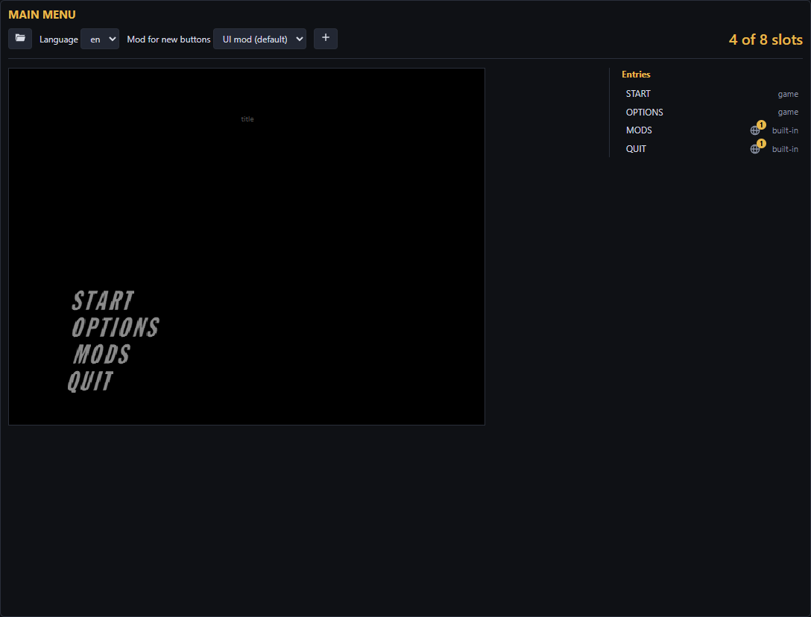

# Make a menu mod

Add, hide, move or rename buttons in the menus and pause menu, or add new pages.

## Open a menu

Open the **Menus** tab and pick a menu to preview it.

## Change it

- **Click** a button to hide or replace it, or add one above or below.
- **Drag** buttons and titles to move them.
- **Language** picks the language shown. Text can be one for all languages or one per language.

## What a button can do

| Type | What it is | Built-in choices |
| --- | --- | --- |
| `action` | Runs when pressed, optionally after a yes/no question | Quit (desktop), reset controls, open the mods folder, touch layout editor (Android), nothing (an info line) |
| `toggle` | On/off setting | Fullscreen, widescreen, frame interpolation, ray-traced lights, shadows, soft shadows, fog shafts, rumble, gyro aiming (Android), cutscene draw distance, frame writeback |
| `cycle` | Steps through choices | Draw distance, resolution, anti-aliasing, frame rate, texture filter, upscale filter |
| `slider` | A bar | Draw distance, mouse sensitivity, mouse smoothing, dead zone |
| `submenu` | Opens a page | A new page (up to 7 buttons plus BACK) or a game menu |
| `label` | Text the cursor skips | |

Settings apply at once and save with the game's settings.

**Shows only if** hides a button unless: on desktop, opened from the front end (not pause), ray tracing works, the Expansion Pak is on, frame interpolation is on, or one of your mod's options is set.

**Custom…** takes a key: `config:<option id>` for one of your mod's options, or `@name` for a function your code mod exports.

## Edit an existing menu mod

**Import** opens a menu mod, such as one from the game's `mods` folder.

## Splitting into several mods

The panel sets which exported mod a new button belongs to; Export mod can change it later.

## Finish

[Try it in the game and export it](Saving-Testing-and-Sharing).

## Not yet possible

Without a code mod, a button can't:

- **Do more than the built-in choices**, such as starting a level. That needs `@name`.
- **Change unlisted settings.** Your mod's options only do something if code reads them.
- **Show live text**, like the co-op lobby status. That needs a native mod.

Always:

- Menus fit 8 lines; **Options** and **Game Settings** are full, so a new button there replaces or hides one.
- A new page holds 7 buttons plus BACK; pause menus about 16 lines.
- Pause menu titles can't change.
- The menu font has capitals, numbers and some punctuation only.
