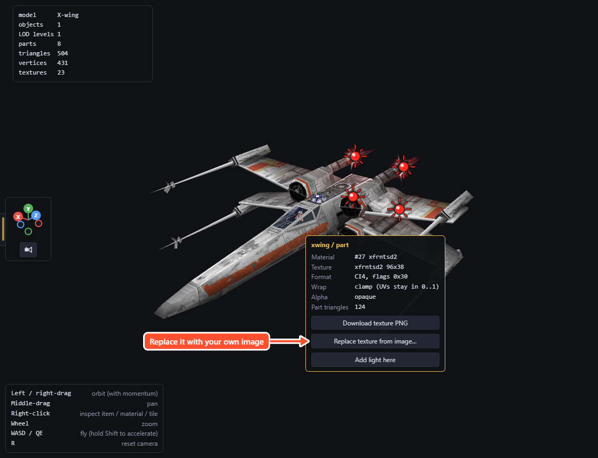

# Make a model mod

Repaint a ship or building, or give a ship, enemy or building a new model.

## Find the model

In **Models**, type in the Filter box. The left panel:

- **LOD**: the far-away versions, each with its own textures. Check every LOD after repainting.
- **Animation**, **Anim speed**: play animations, such as an AT-AT walking.
- **S-foils**, **Speed**: open an X-wing's wings, see engine glow at speed.
- **Textures**, **Wireframe**, **Filtering**, **Lighting**: how it's drawn. *Game (prelit)* matches the N64.

Right-clicking a placed object in a level opens it here; **Back** returns.

## Repaint a texture

1. Right-click a textured part.
2. **Download texture PNG**.
3. Paint over it, keeping its size.
4. Right-click the part again, **Replace texture from image…**.

### Texture tips

- **Format** on the card: *CI4* has 16 colours, *CI8* 256 (from a palette); *RGB16* and *RGB(A)32* any colour.
- Palette textures band soft gradients. Paint with few colours to choose which survive.
- Textures sharing a palette keep its colours, so stay near the original's.
- Transparent pixels stay transparent where the original had them.
- Images are stretched to the texture's size, so match its proportions.
- A level's shared texture changes every object using it. Other levels have their own copies.

## Replace a model with your own

1. Open a model: a player craft such as the X-wing, an enemy such as the probe droid (`imp_stuff/prbdroid`), or a building. Buildings sit in a level's package (`opkg`): pick one in its list.
2. **Import model (.glb)…** (from Blender: *File > Export > glTF 2.0*).

- It's scaled to the model's size, and every LOD gets it. On a craft, the import window can hide the cockpit glass and recolour or remove the exhaust.
- To place the flames, add an Empty named `eng_1`, `eng_2`... where each engine ends and export it with the model. Each flame and engine glow goes to its nearest Empty; the X-wing has four.
- To place the contrails, add Empties named `trl_1`, `trl_2`... at the wingtips. Each contrail goes to its nearest one.
- Name a mesh after a craft part, such as `wngrot_a`, to keep it moving.
- Each texture takes a free slot of the model and is scaled to it. A building whose textures other buildings in the level also use comes in with its colours only.

### Find a craft's moving parts

Right-click a part: moving parts have a **Joint** row (the X-wing's wings are `wngrot_a` and `wngrot_b`). **Export .glb** keeps these names.

### Budgets

Stock crafts have 300-530 triangles and 14-22 textures, most under 100 pixels a side. Imports are limited to 1,500 faces, about 2,900 triangles: two triangles sharing an edge become one face. Past that the game runs out of memory and crashes. The info box shows the triangle count.

The texture on the most triangles gets the first slot; extras past the last slot share it, so pack details into one atlas.

### Example: a simple craft from Blender

1. Model the body with a coloured or textured material, nose toward the **front** view (Numpad 1).
2. Make the wing pairs separate objects named `wngrot_a` and `wngrot_b`.
3. Export everything as **glTF Binary (.glb)**, **Selected Objects** ticked.
4. Open `data/pl_crafts/xwing`, **Import model (.glb)…**, answer **+Z** for the nose.
5. Open the wings: your wing objects move, and the engine glows stay at the back.

## Add a new ship to the hangar

1. Open a hangar craft's model, such as `data/pl_crafts/xwing`.
2. **New ship from this craft…** and name it. The name is what the hangar shows.
3. Its model opens: **Import model (.glb)…** onto it.

Up to eight ships fit. The first three stand between two stock ones, in the order you make them: between the X-wing and the Naboo starfighter, between the V-wing and the Y-wing, then between the snowspeeder and the A-wing. Later ones take the open floor farthest from everything else. **Place in hangar…** on the ship's model shows the hangar floor from above: click where it should stand, then **Place**. It goes on the camera's line through that point, as far from the camera as its craft stands from its own. Turning through the hangar reaches the ships in order round the room. A ship flies with its craft's handling, weapons and sounds, and missions show your model.

A ship also gets its own cockpit, `pl_crafts/c_<ship>`, a copy of its craft's: open it and **Import model (.glb)…** to change it. Its HUD health icon, its blueprint on AVAILABLE CRAFT and its shadow (`pl_crafts/s_<ship>`) are drawn from the model from above, and redrawn after each import; edit them afterwards to sharpen an outline. **Craft line…** imports a .wav or .mp3 the hangar crew says when the ship comes into view, in place of its craft's line. **Abilities…** picks what the special button does: the X-wing's S-foils (they swing your `wngrot_a` and `wngrot_b` parts), the V-wing's boost, nothing, or **Your own**: a toggle or a timed one, with its speed, seconds, cooldown and whether the guns stay off. It also turns on the A-wing's strong aim assist, and its **Rules…** holds rules that run while the ship flies, such as a message when the special engages. AVAILABLE CRAFT lists a ship wherever its craft is available, up to eight craft in all. In cutscenes your ship has its craft's engine sound, and with S-foils its wings open and close as an X-wing's do.

### Animate the special button

A ship can play your own animation when its special button engages (the S-foils close, the boost starts):

1. In Blender, model the ship with its moving parts at rest, each a separate object named after a craft part (the X-wing's are `wngrot_a` and `wngrot_b`; right-click a part to see its **Joint**).
2. Animate those objects from released to engaged, and name the action `special`.
3. Export the .glb with **Animation** ticked and **Import model (.glb)…** it onto the ship. **Animation** on the model then plays it, and **Abilities…** lists the parts it moves.

Releasing plays it backwards. Parts the animation doesn't move keep moving as the craft's own do. **Export .glb** of the X-wing writes its S-foil sweep as an example to start from.

## Use a game model in Blender

**Export .glb** saves what's shown (object, LOD, markers).

## Ray-traced lights on a model

Right-click a part, **Add light here**; drag the bulb to move it.

To make a surface glow instead, right-click it and pick **Make it glow**. Its material then draws at full brightness in game, lit or in shade, even without ray tracing, so every part using that material glows. Give strips or windows their own material to glow alone. Parts drawn only with glowing materials also cast no ray-traced shadow and show in reflections. **Stop it glowing** puts the material back.

The **Ray-traced lights** panel groups lights by *preset*, tied to the model part (**Mesh**) they ride on. It also shows a level's and an effect's lights.

Per light:

- **Colour**, **Strength** (above 1: brighter than white).
- **Radius**: reach. **Radius in camera units** keeps it constant on models drawn at varying sizes, such as laser bolts.
- **Falloff**: how fast it fades (the game mostly uses 2).
- **X**, **Y**, **Z**: position.
- **Shadow offset**: nearer objects don't block it.
- **Flicker**: 0 steady, up to 1.
- **Cone**, **Cone inner**: a spotlight along **Beam X / Y / Z**; 0 shines all around.

The box beside a heading switches it off; the bin deletes it. At the top:

- **Lights from hardpoints**: a light at each glow point.
- **Open lights file**: import another `roguesq_lights.json`.
- **Game's lights** (Chrome and Edge): shows the game folder's lights. Editing one overrides it; deleting one switches it off.

The view shows the 32 nearest lights, close to the game. In game they need ray-traced lights on and a ray-tracing graphics card.

The export writes `roguesq_lights.json`. Built-in lights load first, then mods in Mods-list order; a same-named preset replaces the earlier one. A running game reloads lights within a second, so **Play in game** updates them live.

## Finish

[Try it in the game and export it](Saving-Testing-and-Sharing).
