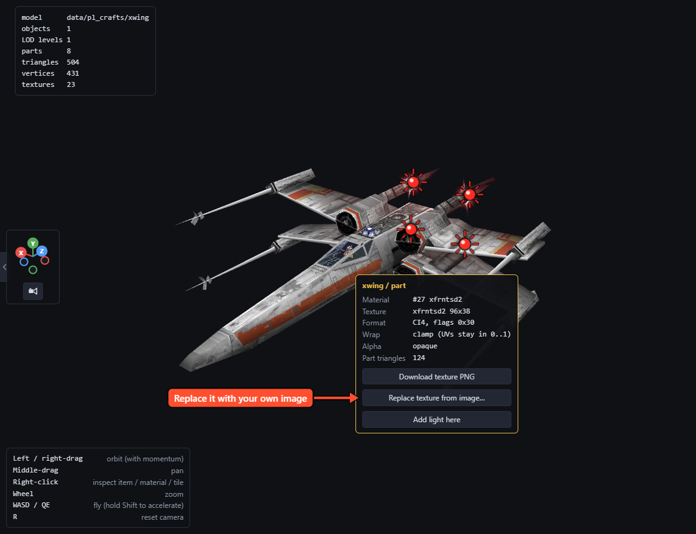

# Make a model mod

Repaint a ship or building, or give a player craft a new model.

## Find the model

In **Models**, type in the Filter box. The left panel:

- **LOD**: the far-away versions, each with its own textures. Check every LOD after repainting.
- **Animation**, **Anim speed**: play animations, such as an AT-AT walking.
- **S-foils**, **Speed**: open an X-wing's wings, see engine glow at speed.
- **Textures**, **Wireframe**, **Filtering**, **Lighting**: how it's drawn. *Game (prelit)* matches the N64.

Right-clicking a placed object in a level opens it here; **Back** returns.

## Repaint a texture

1. Right-click a textured part.
2. **Download texture PNG**.
3. Paint over it, keeping its size.
4. Right-click the part again, **Replace texture from image…**.

### Texture tips

- **Format** on the card: *CI4* has 16 colours, *CI8* 256 (from a palette); *RGB16* and *RGB(A)32* any colour.
- Palette textures band soft gradients. Paint with few colours to choose which survive.
- Textures sharing a palette keep its colours, so stay near the original's.
- Transparent pixels stay transparent where the original had them.
- Images are stretched to the texture's size, so match its proportions.
- A level's shared texture changes every object using it. Other levels have their own copies.
- The Naboo Starfighter's textures are encrypted and can't be replaced yet.

## Replace a player craft with your own model

1. Open a player craft, such as the X-wing.
2. **Import craft model (.glb)…** (from Blender: *File > Export > glTF 2.0*).

- It's scaled to the craft's size; engines, glows and canopy stay.
- Name a mesh after a craft part, such as `wngrot_a`, to keep it moving.
- Each texture takes a free slot of the craft and is scaled to it.

### Find a craft's moving parts

Right-click a part: moving parts have a **Joint** row (the X-wing's wings are `wngrot_a` and `wngrot_b`). **Export .glb** keeps these names.

### Budgets

Stock crafts have 300-530 triangles and 14-22 textures, most under 100 pixels a side. Much heavier models can run out of memory in busy levels; the info box shows the triangle count.

The texture on the most triangles gets the first slot; extras past the last slot share it, so pack details into one atlas.

### Example: a simple craft from Blender

1. Model the body with a coloured or textured material, nose toward the **front** view (Numpad 1).
2. Make the wing pairs separate objects named `wngrot_a` and `wngrot_b`.
3. Export everything as **glTF Binary (.glb)**, **Selected Objects** ticked.
4. Open `data/pl_crafts/xwing`, **Import craft model (.glb)…**, answer **+Z** for the nose.
5. Open the wings: your wing objects move, and the engine glows stay at the back.

## Use a game model in Blender

**Export .glb** saves what's shown (object, LOD, markers).

## Ray-traced lights on a model

Right-click a part, **Add light here**; drag the bulb to move it.

The **Ray-traced lights** panel groups lights by *preset*, tied to the model part (**Mesh**) they ride on. It also shows a level's and an effect's lights.

Per light:

- **Colour**, **Strength** (above 1: brighter than white).
- **Radius**: reach. **Radius in camera units** keeps it constant on models drawn at varying sizes, such as laser bolts.
- **Falloff**: how fast it fades (the game mostly uses 2).
- **X**, **Y**, **Z**: position.
- **Shadow offset**: nearer objects don't block it.
- **Flicker**: 0 steady, up to 1.
- **Cone**, **Cone inner**: a spotlight along **Beam X / Y / Z**; 0 shines all around.

The box beside a heading switches it off; the bin deletes it. At the top:

- **Lights from hardpoints**: a light at each glow point.
- **Open lights file**: import another `roguesq_lights.json`.
- **Game's lights** (Chrome and Edge): shows the game folder's lights. Editing one overrides it; deleting one switches it off.

The view shows the 32 nearest lights, close to the game. In game they need ray-traced lights on and a ray-tracing graphics card.

The export writes `roguesq_lights.json`. Built-in lights load first, then mods in Mods-list order; a same-named preset replaces the earlier one. A running game reloads lights within a second, so **Play in game** updates them live.

## Finish

[Try it in the game and export it](Saving-Testing-and-Sharing).

## Not yet possible

- A model as a **new** selectable ship; imports replace a player craft.
- Importing models for enemies or buildings (their textures can be replaced).
