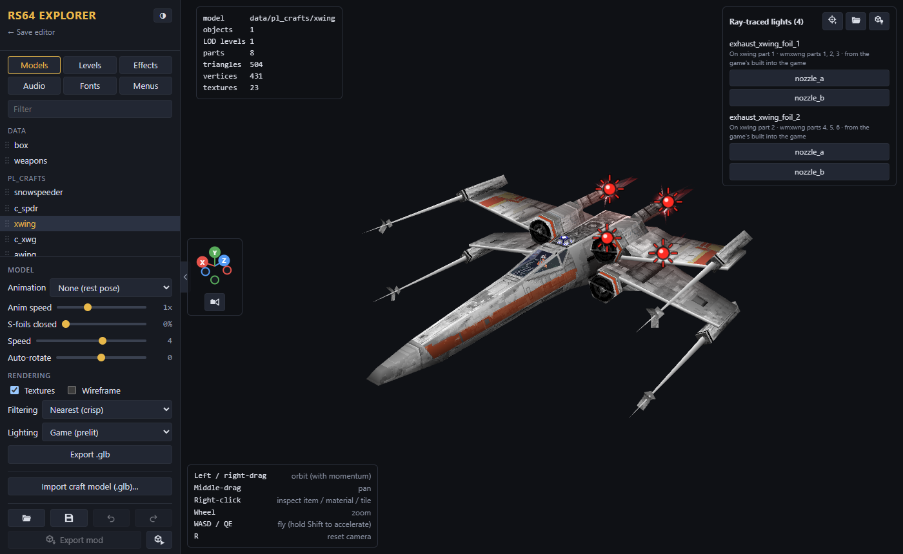

# Getting started

## What you need

- **Your own ROM** of *Star Wars: Rogue Squadron* (USA v1.0). The explorer reads everything from it, and it never leaves your computer.
- **Chrome or Edge** on desktop. Other browsers can view and export, but not [Play in game](Saving-Testing-and-Sharing#play-in-game).
- **[The game](https://github.com/MikeSemicolonD/RogueSquadron64Recomp/releases)**, to play what you make.

Open the [RS64 Explorer](https://mikesemicolond.github.io/RogueSquadron64Recomp/tools/web/rs64-explorer/) and drop your ROM on it. **What do you want to make?** (the flag button) shows where to start.

## Moving around the view

The help box in the corner lists the controls for what you're doing. The common ones:

| Do this | To |
| --- | --- |
| Left- or right-drag | Orbit |
| Middle-drag | Pan |
| Mouse wheel | Zoom |
| W A S D, Q E | Fly (Shift: faster). While editing, hold the right mouse button |
| R | Reset the camera (not while editing) |
| Right-click | Inspect what's under the cursor. While editing: pick from everything there |

The axis cube in the corner faces the view along an axis; its camera button (or numpad 5) toggles a flat view.

## Keyboard shortcuts

| Keys | Action |
| --- | --- |
| Ctrl+Z / Ctrl+Y (or Ctrl+Shift+Z) | Undo / redo |
| Ctrl+S | Save project |
| Q / W / E / R | While editing: select, move, rotate, scale |
| X | While editing: world / local axes |
| Tab / Shift+Tab | Next / previous edit mode |
| Ctrl+D | Duplicate |
| Delete | Delete |
| V | Cutscene editor: snap the picked camera or actor to the view |
| Esc | Cancel placing or dragging |

## Looking before you change

These tabs help find what to mod:

- **Effects**: explosions, fire, smoke and other animated sprites.
- **Audio**: sounds, voice lines (listed by what they say) and music.
- **Fonts**: the game's fonts, and letters for a translation ([language modding guide](https://github.com/MikeSemicolonD/RogueSquadron64Recomp/blob/main/docs/guides/modding-languages.md)).

## Troubleshooting

**The ROM is rejected.** The reason shows under the drop box. It must be the USA v1.0 game; `.z64`, `.v64` and `.n64` all work. *Not a Rogue Squadron N64 ROM* usually means it's still zipped.

**The view stays blank.** Turn on hardware acceleration (Chrome: *Settings > System > Use graphics acceleration when available*; `chrome://gpu` shows if it works) in a recent Chrome, Edge or Firefox.

**My edits are gone.** Edits live in the page until you **Save project**; the page warns before closing with unsaved edits. A project opens only with its ROM, and an exported mod can't be opened as a project, so keep the project file.
